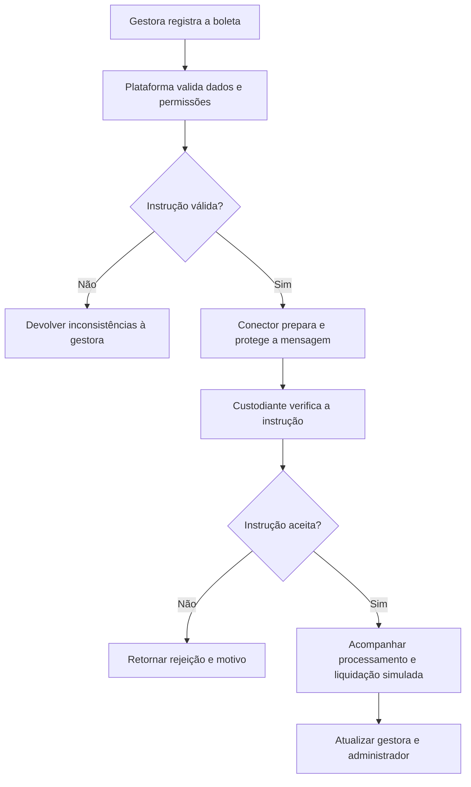
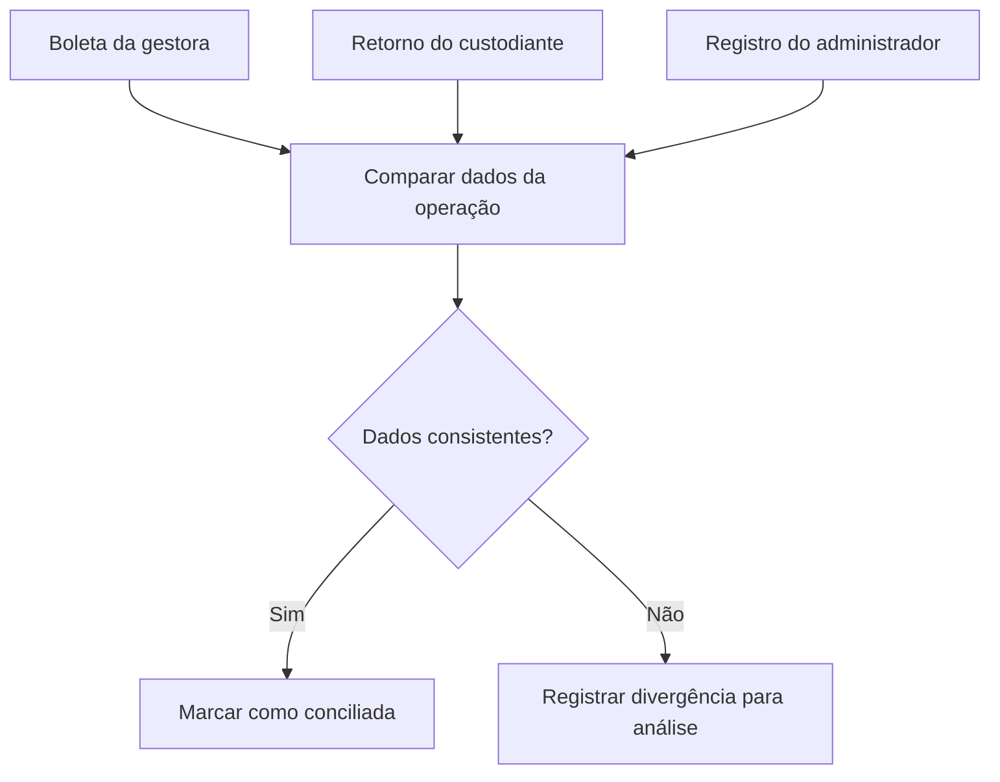

# Crypto-Agile Financial Integrations

Plataforma de integração entre gestoras, administradores fiduciários e custodiantes, via APIs REST e Web Services SOAP, com foco em criptoagilidade e migração para criptografia pós-quântica.

> Projeto acadêmico desenvolvido para a eletiva Tópicos Avançados de Criptografia. Em fase de especificação; os serviços e experimentos descritos a seguir ainda serão implementados.

## Visão geral

As integrações entre instituições financeiras sustentam o envio de operações, a consulta de posições e movimentações e o acompanhamento da liquidação de ativos. Essas conexões dependem de autenticação, certificados, chaves e algoritmos criptográficos. A substituição desses elementos em uma migração pós-quântica pode comprometer a interoperabilidade e a continuidade dos processos.

O projeto propõe uma camada de integração com componentes criptográficos substituíveis e políticas específicas por participante, para experimentar a transição entre perfis tradicional, pós-quântico e combinado. A ISO/IEC 25010 orienta os requisitos de qualidade, com ênfase em segurança, compatibilidade e eficiência de desempenho.

**Questão de pesquisa:** qual o custo operacional e de compatibilidade de migrar, de forma gradual e sem interromper o processamento, integrações heterogêneas (REST/JSON e SOAP/XML) para criptografia pós-quântica?

## Cenário

Segundo o Banco Central do Brasil, o Sistema Financeiro Nacional (SFN) compreende as entidades e instituições que promovem a intermediação financeira, aproximando os agentes que disponibilizam recursos daqueles que necessitam de financiamento.

Nesse sistema, gestoras de recursos, administradores fiduciários e custodiantes exercem funções distintas e complementares de gestão, administração e custódia dos investimentos, e trocam informações para o processamento e o acompanhamento das operações. O cenário inicial simula esses três participantes (Tabela 1).

Tabela 1: Agentes de Mercado

| Participante | Atuação no SFN (síntese com base em materiais da CVM) | Responsabilidade no cenário |
|---|---|---|
| Gestora de recursos | Gestão da carteira de valores mobiliários, incluindo decisões de alocação e negociação, conforme mandato, política de investimento e limites regulatórios. | Enviar instruções de operações via API e acompanhar aceitação, rejeição e processamento. |
| Administrador fiduciário | Administração fiduciária do fundo: manutenção de registros e documentos, prestação de informações e contratação e acompanhamento de serviços. | Receber informações das operações e manter registros e controles do fundo. |
| Custodiante | Custódia de valores mobiliários: conservação e controle dos ativos, conciliação com o depositário central, processamento de instruções de movimentação e tratamento de eventos. | Receber instruções, simular a liquidação e informar posições e movimentações. |

Fonte: material elaborado pelos autores (2026).

As responsabilidades no cenário constituem um recorte experimental e não abrangem as atribuições regulatórias integrais dos participantes.

## Fluxo inicial

O fluxo representa a integração entre gestora, custodiante e administrador após a negociação de uma operação de renda fixa. A negociação com a contraparte ocorre fora da plataforma; o fluxo inicia com o registro da operação em uma boleta. O exemplo considera a compra fictícia de uma debênture no mercado secundário (Tabela 2).

Tabela 2: Boleta da Operação

| Campo | Valor de exemplo |
|---|---|
| Identificador da operação | OP-000001 |
| Carteira | Fundo Alfa |
| Tipo de operação | Compra definitiva |
| Tipo de ativo | Debênture |
| Identificador do ativo | DEB-FICTICIA-01 |
| Emissor do ativo | Companhia Exemplo |
| Contraparte | Instituição Beta |
| Data de negociação | D |
| Data de liquidação acordada | D+1 útil |
| Indexador | IPCA |
| Taxa de emissão | IPCA + 6,00% a.a. |
| Taxa negociada | IPCA + 6,50% a.a. |
| Quantidade | 100 |
| PU de negociação | R$ 980,500000 |
| Valor financeiro bruto | R$ 98.050,00 |
| Moeda | BRL |
| Custodiante | Custodiante Gama |
| Administrador fiduciário | Administrador Delta |

Fonte: material elaborado pelos autores (2026).

O processamento segue as etapas abaixo:

1. **Registro da boleta:** a gestora informa condições negociadas, carteira, ativo e contraparte. A plataforma atribui um identificador único e registra a versão da instrução.

2. **Validação local:** a plataforma verifica campos obrigatórios, permissões, cadastros, datas, duplicidade e consistência entre quantidade, PU e financeiro. A validação entre taxa e PU depende de um motor de cálculo compatível com o título e não integra o escopo inicial.

3. **Preparação e proteção:** o conector adapta a instrução ao contrato REST/JSON ou SOAP/XML do destinatário e aplica o perfil criptográfico da integração. A assinatura protege os dados financeiros e o contexto da mensagem: emissor, destinatário, ambiente, identificador, versão e validade.

4. **Recebimento e aceitação:** o custodiante simulado verifica a proteção criptográfica, a autorização, a validade e as regras operacionais, e retorna aceitação ou rejeição com justificativa. O reenvio da mesma instrução não gera nova operação; o mesmo identificador com conteúdo diferente gera conflito.

5. **Liquidação simulada:** a plataforma acompanha a operação por consultas de status no MVP. Em uma compra, a simulação considera a saída de recursos e a entrada dos títulos na carteira. Impedimentos geram pendência ou falha com motivo informado.

6. **Atualização e conciliação:** o administrador recebe os dados para os registros e controles do fundo. A plataforma compara as informações dos participantes e sinaliza divergências de carteira, ativo, quantidade, taxa negociada, PU, financeiro ou data de liquidação.

A conciliação verifica se os registros dos participantes representam a mesma operação:

Os estados da operação são apresentados na Tabela 3.

Tabela 3: Status das Operações

| Estado | Significado |
|---|---|
| Registrada | A boleta foi salva na plataforma. |
| Validada | A instrução passou pelas verificações locais. |
| Enviada | A instrução foi transmitida ao destinatário. |
| Recebida | O destinatário confirmou o recebimento. |
| Aceita | A instrução foi aprovada para processamento. |
| Rejeitada | A instrução não foi aceita, com motivo informado. |
| Pendente de liquidação | A operação aguarda as condições da liquidação simulada. |
| Liquidada | A simulação confirmou a movimentação financeira e dos ativos. |
| Falha na liquidação | A simulação identificou impedimento à conclusão. |

Fonte: material elaborado pelos autores (2026).

**Recebimento, aceitação e liquidação são eventos distintos.** A confirmação de recebimento não implica aceitação ou liquidação. Na ausência de confirmação conclusiva, a plataforma consulta o estado antes de repetir o envio.

O resultado da conciliação é acompanhado separadamente: uma operação pode estar liquidada e ainda apresentar divergências entre os registros. Todo o fluxo utiliza dados sintéticos, sem movimentação em infraestrutura real de mercado.

## Criptoagilidade

A criptoagilidade é aplicada ao estabelecimento de chaves nas conexões e às assinaturas das mensagens financeiras. Esses mecanismos são configurados por integração e desacoplados da lógica de negócio, o que permite sua evolução sem alterar o processamento das operações.

| Camada | Aplicação no projeto | Mecanismos previstos |
|---|---|---|
| Estabelecimento de chaves | Estabelecer os segredos que protegem o canal de comunicação. | X25519 e grupo híbrido X25519MLKEM768, em TLS 1.3. |
| Proteção do transporte | Cifrar e verificar a integridade dos dados transmitidos, com chaves derivadas pelo TLS. | Criptografia autenticada, como AES-GCM. |
| Assinatura das mensagens | Verificar a autenticidade e a integridade de boletas e confirmações, independentemente da conexão. | ECDSA P-256, ML-DSA-65 e perfil duplo com ambas as assinaturas obrigatórias. |

O estabelecimento híbrido combina mecanismos tradicionais e pós-quânticos, mas não torna a autenticação do canal pós-quântica. Os certificados e algoritmos de assinatura do TLS são identificados separadamente e, neste projeto, utilizam algoritmos tradicionais (limitação declarada). A autenticação pós-quântica é aplicada na camada de mensagem.

Cada integração possui uma política que define grupos de estabelecimento de chaves, perfis de assinatura e chaves autorizadas. A implementação utiliza protocolos e bibliotecas consolidados, sem desenvolver algoritmos ou combinações criptográficas próprias.

A demonstração contempla a migração entre configurações, a rotação de chaves, o tratamento de conexões e mensagens em andamento e a rejeição de mecanismos desabilitados. Mudanças no grupo de estabelecimento de chaves exigem novas conexões. Incompatibilidades geram falhas explícitas, sem redução automática da proteção exigida (*downgrade*).

## Escopo do MVP

O MVP deve demonstrar uma compra de debênture de ponta a ponta, com três participantes simulados, persistência do estado e troca de política criptográfica durante o processamento. O recorte utiliza um custodiante REST/JSON e um administrador SOAP/XML; a gestora envia a boleta pela API da plataforma. Os conectores traduzem os contratos externos para um modelo interno comum.

| Entrega | Implementação mínima | Critério de aceite |
|---|---|---|
| Registro e controle da operação | Boleta da Tabela 2, validações locais, autorização e histórico de estados persistido. | Dados inválidos são rejeitados com motivo; uma boleta válida recebe identificador e pode ser consultada. |
| Integração com os participantes | Envio ao custodiante, consulta de status e atualização do administrador, com contratos OpenAPI e WSDL/XSD. | A operação percorre aceitação, liquidação simulada e registro no administrador, com rastreabilidade pelo identificador. |
| Reenvio e conciliação | Idempotência por emissor, identificador e versão; comparação dos campos financeiros entre os registros. | Reenvio idêntico não duplica o processamento; conteúdo diferente para a mesma chave gera conflito; divergência inserida no teste é identificada. |
| Proteção das mensagens | Conteúdo assinado e canonicalização definidos por contrato; provedores ECDSA P-256 e ML-DSA-65; perfil duplo exigindo ambas as assinaturas. | Instruções e confirmações válidas são verificadas; adulteração, expiração, destinatário incorreto e chave não autorizada são rejeitados. |
| Política e migração | Configuração por integração, TLS 1.3 tradicional ou híbrido, rotação de chaves e regra explícita para mensagens e conexões em andamento. | A política muda sem alterar a lógica financeira; novas conexões usam o grupo exigido; mensagens em trânsito seguem a política de transição; mecanismos desabilitados não são aceitos fora dela. |
| Evidências de execução | Logs com operação, versão da política, identificador de chave, mecanismos utilizados e resultado; scripts de demonstração e medição. | O fluxo, as falhas previstas e a migração são reproduzíveis, sem registrar chaves privadas nos logs. |

**Conclusão do MVP:** executar o fluxo financeiro, demonstrar os três perfis de assinatura e os dois grupos de estabelecimento de chaves, migrar com operações em andamento sem perda ou duplicidade e produzir as evidências da avaliação abaixo.

**Fora do escopo:** instituições e infraestrutura reais de mercado, movimentação financeira real, cálculo de PU a partir da taxa, negociação com contrapartes, autenticação pós-quântica do TLS, HSM e interface gráfica. A execução utiliza dados sintéticos, APIs e scripts; notificações assíncronas ficam para uma evolução posterior.

## Plano de desenvolvimento

O plano mantém cinco semanas como referência, com uma entrega executável por etapa. Os critérios de conclusão orientam o avanço; a escolha da stack depende da validação das bibliotecas na primeira semana.

| Semana | Trabalho e entrega | Critério de conclusão |
|---|---|---|
| 1 — Contratos e viabilidade | Definir modelo da boleta, transições de estado, contratos REST/SOAP, conteúdo assinado e ameaças consideradas. Executar uma prova mínima de assinatura/verificação ECDSA e ML-DSA e de negociação TLS com os dois grupos previstos. | Contratos e vetores de mensagem disponíveis; algoritmos executados e grupo TLS negociado confirmado no ambiente escolhido. Limitações de suporte registradas antes de implementar os conectores. |
| 2 — Fluxo tradicional completo | Implementar API da gestora, persistência, custodiante REST, administrador SOAP e consulta de status. Integrar ECDSA e TLS tradicional, autorização, idempotência e conciliação. | Um script registra, envia, acompanha e concilia a operação em C1; testes cobrem rejeição, reenvio, conflito e divergência. |
| 3 — Perfis substituíveis | Integrar ML-DSA, perfil duplo, TLS híbrido e políticas por integração. Instrumentar tempos, tamanhos, recursos e mecanismos efetivamente utilizados. | As seis configurações executam os contratos REST/SOAP; mensagens inválidas são rejeitadas, inclusive quando falta uma assinatura no perfil duplo. |
| 4 — Migração e piloto | Implementar rotação de chaves, ativação de políticas e transição de conexões e mensagens. Testar incompatibilidade e tentativa de downgrade. Executar o piloto e fixar os parâmetros da coleta. | Migração e rotação ocorrem sob carga com rastreabilidade, sem perda ou duplicidade; falhas são explícitas; protocolo final e scripts estão prontos para repetição. |
| 5 — Experimentos e entrega | Executar a coleta definitiva de primitivas, TLS, fluxo integrado e migração. Gerar análise comparativa, limitações, instruções de execução e roteiro de demonstração. | Dados brutos, configurações e relatório permitem reproduzir e interpretar os resultados; demonstração atende aos critérios do MVP. |

## Metodologia de avaliação

A avaliação compara custo computacional, tráfego e continuidade do processamento, usando a ISO/IEC 25010 como referência para segurança, compatibilidade e eficiência de desempenho. Os testes funcionais e de segurança precedem a coleta de desempenho.

### Configurações e medidas

O experimento cruza dois grupos de estabelecimento de chaves com três perfis de assinatura (fatorial 2 × 3). **C1 é a referência**; a autenticação TLS permanece tradicional em todas as configurações.

| Configuração | Estabelecimento de chaves | Assinatura da mensagem |
|---|---|---|
| C1 (referência) | X25519 | ECDSA P-256 |
| C2 | X25519 | ML-DSA-65 |
| C3 | X25519 | ECDSA P-256 + ML-DSA-65 |
| C4 | X25519MLKEM768 | ECDSA P-256 |
| C5 | X25519MLKEM768 | ML-DSA-65 |
| C6 | X25519MLKEM768 | ECDSA P-256 + ML-DSA-65 |

| Medição | Métricas e limites da medida |
|---|---|
| Primitivas | Tempo de geração de chaves, assinatura e verificação (µs), sem serialização; tamanho de chave pública e assinatura (bytes). |
| Conexão TLS | Tempo do início da conexão à conclusão do handshake (ms), bytes e pacotes trocados, sem retomada de sessão. |
| Fluxo REST/JSON e SOAP/XML | Latência do envio até aceitação ou rejeição e da consulta de status (ms); canonicalização e serialização separadas (µs); tamanho do envelope (bytes), vazão (ops/s), CPU e memória por processo. A espera pela liquidação simulada não compõe a latência de aceitação. |
| Migração e rotação | Taxa de erro, perdas, duplicidades e tempo de convergência: da ativação da política até todas as novas mensagens e conexões usarem a configuração-alvo. |

As seis configurações são comparadas sob o mesmo contrato e carga. Para separar o efeito do protocolo do papel de cada participante, os testes dos conectores usam instruções equivalentes em REST e SOAP; o fluxo integrado valida o cenário completo. Falhas, rejeições indevidas e timeouts são contabilizados separadamente das rejeições esperadas nos testes negativos.

### Execução e controles

1. **Preparar o ambiente:** registrar hardware, sistema operacional, versões fixadas das bibliotecas, afinidade e política de frequência da CPU. Usar máquina dedicada ou VM com recursos fixos e sem carga concorrente. Gerar boletas com semente e tamanho fixos por cenário; medir tempos com relógio monotônico e minimizar a interferência da instrumentação.
2. **Validar em piloto:** conferir tamanhos de chaves e assinaturas com as especificações, estabilidade das medidas e rejeição de mensagens adulteradas, expiradas ou com contexto incorreto. Confirmar o grupo TLS negociado e os algoritmos utilizados; invalidar execuções com mecanismos diferentes dos configurados. Ajustar e registrar aquecimento, amostragem e duração antes da coleta definitiva.
3. **Coletar com repetição:** adotar inicialmente 30 execuções independentes por cenário, com processos reiniciados e configurações intercaladas em ordem aleatória de semente registrada. Por execução, coletar ao menos 10.000 amostras de primitivas, 1.000 conexões TLS e 5.000 ciclos de envio e consulta. Descartar o aquecimento: nas primitivas, pelo menos 1.000 iterações e 10 s; no TLS, 200 conexões; no fluxo, 500 ciclos. Esses valores são confirmados ou ajustados no piloto.
4. **Controlar rede e carga:** avaliar loopback e rede emulada com RTT de 20 e 80 ms. No fluxo, separar conexões novas de persistentes, com retomada TLS desabilitada; medir handshakes isolados sempre em conexões novas. Avaliar limites de concorrência de 1, 8 e 32 clientes e taxa de chegada fixa (*open-loop*), registrando filas, atrasos e requisições não atendidas para evitar omissão coordenada. Determinar a vazão máxima sustentável por rampa de carga, registrando duração dos patamares, saturação e primeiro erro.
5. **Exercitar a transição:** manter carga constante nas migrações C1→C4, C1→C5 e C1→C6 e na rotação de chaves, com operações em trânsito no instante da troca. Repetir os cenários e registrar janela de transição, política aplicada e tempo de convergência. Exigir zero perdas e duplicidades, verificadas pela correspondência entre instruções enviadas e registros finais; incompatibilidade e downgrade devem produzir falhas explícitas.

### Análise e reprodução

Reportar mediana, intervalo interquartil, p95 e p99 das latências; média e desvio-padrão de vazão e recursos entre execuções; e sobrecarga de tempo e bytes em relação a C1, sob condições equivalentes. A unidade independente de análise é a **execução**, não cada requisição. Calcular intervalos de confiança de 95% por bootstrap com 10.000 reamostragens entre execuções, inclusive para as razões em relação à referência. Manter os valores atípicos e discutir sua influência.

Os critérios funcionais exigem aceitação de mensagens legítimas, rejeição das violações previstas e ausência de perdas e duplicidades na migração. O desempenho é comparativo, sem limite absoluto de aprovação previamente definido. Diferenças entre bibliotecas, variabilidade do ambiente, carga sintética e ausência de HSM limitam a atribuição dos custos aos algoritmos e a generalização para produção.

A implementação deverá reunir em `bench/` o manifesto do ambiente, configurações, sementes, scripts de execução e análise, dados brutos e tabelas e gráficos gerados. O relatório identificará a revisão do código e os parâmetros de cada experimento. Um comando documentado deverá reproduzir a coleta e a análise; esses artefatos ainda fazem parte do plano de desenvolvimento.
