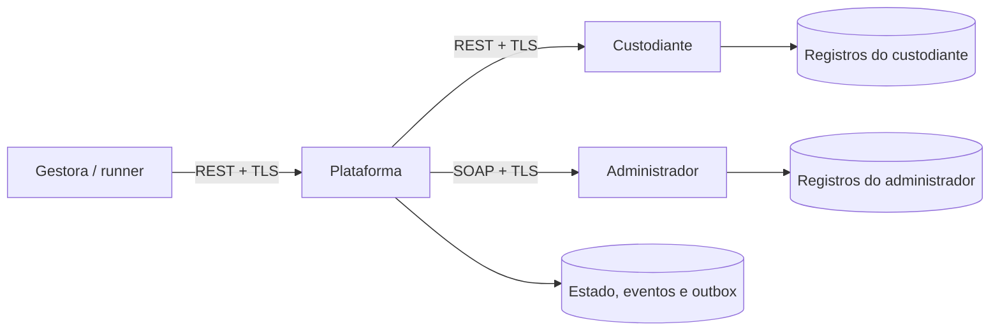

# Especificação técnica — Crypto-Agile Financial Integrations

**Status:** especificação para implementação do MVP. **Versão:** 0.1. **Data:** 2026-11-19.

Este documento detalha o [README](README.md) e define comportamentos, contratos e critérios de conclusão. A [Sprint 1](docs/sprint-1/README.md) entregou contratos, vetores e provas isoladas; os serviços e comandos operacionais do MVP ainda serão implementados. Alterações que afetem contratos, segurança ou resultados experimentais devem atualizar esta especificação e registrar a justificativa em uma decisão de arquitetura (ADR).

## 1. Objetivo e limites

Implementar um ambiente reproduzível no qual uma gestora registra uma compra fictícia de debênture, um custodiante REST processa e simula a liquidação, e um administrador SOAP registra o resultado. A plataforma deve conciliar os registros e permitir a troca de perfis criptográficos por integração sem modificar as regras financeiras.

O MVP cobre ECDSA P-256, ML-DSA-65 e assinatura dupla na camada de mensagem; X25519 e X25519MLKEM768 no estabelecimento de chaves TLS 1.3. Certificados e autenticação TLS permanecem tradicionais. Não inclui instituições reais, negociação, cálculo de PU a partir da taxa, HSM, interface gráfica, notificações assíncronas externas ou autenticação TLS pós-quântica.

**Invariantes:** uma instrução produz no máximo um efeito financeiro simulado; recebimento não significa aceitação; aceitação não significa liquidação; divergência de conciliação não altera o estado da liquidação; falha técnica não implica rejeição financeira; nenhum mecanismo exigido pode ser reduzido automaticamente para contornar incompatibilidade.

## 2. Arquitetura e execução

| Componente | Responsabilidade |
|---|---|
| `platform` | API da gestora, validação, persistência, orquestração, consultas, conciliação e administração de políticas. |
| `custodian-simulator` | API REST, deduplicação, aceitação/rejeição, liquidação simulada e consulta de registros. |
| `administrator-simulator` | Serviço SOAP, deduplicação, registro da operação e consulta dos dados registrados. |
| `crypto` | Provedores de assinatura e verificação, resolução de chaves e canonicalização; sem regras financeiras. |
| `transport` | Clientes/servidores TLS, configuração de grupos, identidade do par e evidência do mecanismo negociado. |
| `runner` | Gestora simulada, cenários de falha, demonstração e geração de carga. |



A plataforma pode ser um único serviço com worker interno. Os simuladores devem executar em processos separados, com armazenamento independente; podem compartilhar uma instância de banco com bases e credenciais distintas. Não introduzir broker no MVP: usar fila persistida no banco (*outbox*) e consulta periódica. Falhas de um participante não devem apagar o estado dos demais.

O ambiente de referência será Linux em contêineres, com configuração equivalente em Docker Compose. Desenvolvimento no Windows pode usar WSL2. O banco deve suportar transações, unicidade e atualização concorrente; PostgreSQL é a escolha de referência. Versões e imagens dos serviços serão fixadas após a validação da stack.

Para a persistência de laboratório C1, o [Compose S2-04](deploy/persistence/compose.yaml) fixa PostgreSQL 17.7 Bookworm Linux `amd64` por digest. A [preparação por cenário](deploy/persistence/README.md) materializa três bases e logins distintos na mesma instância, com credenciais em volumes externos ao checkout.

**Viabilidade em laboratório:** a [ADR 0001](docs/adr/0001-stack.md) registra CPython 3.13.11 com `ctypes` e OpenSSL 3.5.9 como referência. A [verificação final da Sprint 1](docs/sprint-1/evidence/final-verification.json) conferiu JCS e Exclusive XML C14N 1.0 contra bytes de referência, gerou e verificou assinaturas nos perfis `ECDSA`, `ML_DSA` e `DUAL` sobre vetores JSON/XML e observou os dois grupos TLS via API, em mTLS com terminação direta no harness. Essas provas não aprovam a stack dos serviços.

**Gate de stack dos serviços:** antes de implementar o fluxo C1, demonstrar no runtime escolhido assinatura e verificação com ambos os algoritmos e canonicalização interoperável com os parsers selecionados. Nos clientes e servidores REST/SOAP candidatos, em processos separados, demonstrar mTLS, identidade vinculada à política e controle e observação dos grupos X25519 e X25519MLKEM768 efetivamente negociados, sem fallback. O suporte não pode ser inferido da versão instalada. Registrar na ADR a linguagem, o runtime, os frameworks, clientes, servidores e bibliotecas selecionados, com suas versões, o mecanismo de observação do grupo negociado e os comandos e evidências das provas. [OpenSSL: ML-DSA](https://docs.openssl.org/3.5/man7/EVP_SIGNATURE-ML-DSA/), [OpenSSL: configuração TLS](https://docs.openssl.org/3.5/man3/SSL_CONF_cmd/).

Não usar execução de processos de linha de comando por assinatura na aplicação ou no benchmark de primitivas. Se a terminação TLS exigir componente separado, documentar a fronteira de confiança, proteger o trecho interno e incluir seu custo nas medições; o grupo negociado deve vir do terminador, nunca de um cabeçalho fornecido pelo cliente.

**Resultado do gate S2-02/S2-03:** a [ADR 0001](docs/adr/0001-stack.md#decisão-para-os-serviços--s2-03) seleciona terminação direta nos adaptadores CPython/OpenSSL e HTTP/1.1 via h11 para REST e SOAP 1.2. O corpo bruto segue para os parsers de S2-02. As [trocas mínimas nos três enlaces](docs/sprint-2/evidence/s2-03.json) observaram os dois grupos nas duas pontas, com a suíte e os controles de sessão do §5; a [regressão dos parsers e assinaturas](docs/sprint-2/evidence/s2-03-body.json) passou na imagem do transporte. O fluxo financeiro C1 e sua autorização operacional continuam dependentes de integração.

## 3. Modelo de domínio e persistência

### Boleta

Todos os campos abaixo são obrigatórios. Identificadores de cadastro usam de 1 a 64 caracteres ASCII (`A-Z`, `a-z`, `0-9`, `_`, `-`); nomes descritivos pertencem ao cadastro. Valores monetários e taxas usam strings decimais de escala fixa na API e tipos decimais exatos no domínio e no banco. Não usar ponto flutuante binário.

| Campo | Tipo / regra | Exemplo |
|---|---|---|
| `clientOrderId` | Identificador único por gestora; referencia a boleta de origem. | `OP-000001` |
| `portfolioId` | Carteira cadastrada e autorizada para a gestora. | `FUNDO-ALFA` |
| `operationType` / `assetType` | Valores fixos no MVP: `BUY` / `DEBENTURE`. | `BUY` / `DEBENTURE` |
| `assetId` / `issuerId` | Ativo e emissor cadastrados e relacionados. | `DEB-FICTICIA-01` / `EMISSOR-01` |
| `counterpartyId` | Contraparte cadastrada. | `INSTITUICAO-BETA` |
| `tradeDate` / `settlementDate` | Datas ISO `YYYY-MM-DD`; liquidação não anterior à negociação. | `2026-11-19` / `2026-11-20` |
| `indexer` | Valor fixo `IPCA`. | `IPCA` |
| `issueRate` / `negotiatedRate` | Spread anual sobre IPCA, em pontos percentuais, seis casas; intervalo de 0 a 100. | `6.000000` / `6.500000` |
| `quantity` | Inteiro positivo, até 999.999.999, representado como string. | `100` |
| `unitPrice` | Decimal positivo `(20,6)`, seis casas. | `980.500000` |
| `grossAmount` | Decimal positivo `(20,2)`, duas casas. | `98050.00` |
| `currency` | Valor fixo `BRL`. | `BRL` |
| `custodianId` / `administratorId` | Participantes cadastrados para a carteira. | `CUSTODIANTE-GAMA` / `ADMINISTRADOR-DELTA` |

Validar `grossAmount = round(quantity × unitPrice, 2, HALF_UP)` e rejeitar overflow. Não inferir PU pela taxa. O calendário do simulador considera apenas segunda a sexta, sem feriados; essa simplificação deve aparecer no cenário e não representar calendário de mercado. As datas do exemplo são ilustrativas; a fixture deve gerar datas válidas a partir do relógio simulado.

A plataforma atribui `operationId` (UUID), `instructionVersion = 1`, `createdAt` e `updatedAt`. A boleta é imutável no MVP: não há alteração, cancelamento ou segunda versão de uma operação. A versão permanece no contrato para evolução; valores diferentes de 1 são rejeitados. IDs de mensagens são distintos do ID da operação.

### Estados e registros

| Estado atual | Próximo estado | Condição |
|---|---|---|
| `REGISTERED` | `VALIDATED` | Validação local concluída. No caminho válido, ambos os eventos podem ser gravados na mesma transação. |
| `REGISTERED` | `REJECTED` | Falha de validação de domínio, com origem `LOCAL`. Erros de sintaxe não criam operação. |
| `VALIDATED` | `SENT` | Tentativa de envio persistida; o resultado remoto pode ainda ser desconhecido. |
| `SENT` | `RECEIVED` | Resposta verificada confirma persistência no custodiante. |
| `RECEIVED` | `ACCEPTED` ou `REJECTED` | Decisão operacional do custodiante, com motivo em caso de rejeição. |
| `ACCEPTED` | `PENDING_SETTLEMENT` | Liquidação agendada no simulador. |
| `PENDING_SETTLEMENT` | `SETTLED` ou `SETTLEMENT_FAILED` | Resultado determinístico da simulação. |

`REJECTED`, `SETTLED` e `SETTLEMENT_FAILED` são terminais. Timeout mantém o último estado financeiro conhecido e marca a entrega como `UNKNOWN`; não cria rejeição. Respostas de consulta incluem sequência crescente e histórico de eventos do custodiante, permitindo reconstruir estados intermediários após queda. Ignorar eventos já aplicados; rejeitar regressões, lacunas não resolvidas e transições inválidas.

Manter `deliveryStatus` (`PENDING`, `UNKNOWN`, `CONFIRMED`, `BLOCKED`) por destinatário e `reconciliationStatus` (`NOT_READY`, `MATCHED`, `DIVERGENT`) separados do estado financeiro. O administrador recebe uma instrução de registro após o estado terminal do custodiante; indisponibilidade do administrador mantém a conciliação em `NOT_READY` e a atualização pendente.

| Registro persistido | Conteúdo e restrições |
|---|---|
| `operations` | Boleta imutável, estados e versão de concorrência; unicidade `(managerId, clientOrderId)`. |
| `operation_events` | Sequência por operação, origem, estado anterior/novo, motivo e horário; append-only pela aplicação. |
| `outbox` | Destinatário, tipo, payload, identidade lógica, envelope preparado, tentativas e próxima execução. Gravação atômica com a mudança que exige envio. |
| `inbox` | Emissor, destinatário, tipo, operação, versão, digest do conteúdo de negócio e resultado; chave única de deduplicação. |
| `message_receipts` | `messageId`, digest do envelope verificado, resultado e horário; detecta reutilização conflitante de ID. |
| `policies` / `key_registry` | Versões imutáveis de políticas, metadados e chaves públicas; referências às privadas, nunca seu conteúdo. |
| `reconciliation_results` | Snapshots comparados, revisão dos registros e divergências por campo. |

Aplicar deduplicação, efeito de negócio e registro do resultado na mesma transação no destinatário. Usar restrições de unicidade e controle concorrente; uma verificação prévia isolada não evita corrida. Na liquidação, gravar débito de caixa e crédito de ativos de forma atômica, com unicidade por operação e tipo de lançamento. Após reinício, reconstruir o trabalho a partir do estado persistido.

## 4. Contratos de integração

Na [plataforma C1 da S2-06](deploy/platform/README.md), o login `platform` grava recibo, boleta,
eventos e intenção em uma transação PostgreSQL. O resultado de criação usa a decisão inicial;
a consulta autenticada lê o histórico atual. A migração se aplica apenas à base da plataforma.
A [verificação com conexões concorrentes](docs/sprint-2/evidence/s2-06.json) cobre esses dois POSTs.
Em consulta já autenticada, divergência entre UUID da rota e UUID assinado retorna `400`
com `ERROR/INVALID_SCHEMA` correlacionado à mensagem e ao UUID protegidos, antes da consulta de titularidade.

A [baseline congelada da Sprint 1](docs/sprint-1/README.md#congelamento-e-compatibilidade) é a referência para os conectores: inclui [OpenAPI para REST](contracts/openapi/), [WSDL/XSD para SOAP](contracts/soap/) e exemplos e vetores em `contracts/`. Avaliar a compatibilidade antes de alterar esses artefatos; mudanças incompatíveis exigem versão e migração explícitas, atualização dos vetores e repetição das verificações afetadas e da verificação integrada. Rejeitar campos desconhecidos ou duplicados e tipos ou versões não suportados. Usar UTF-8, timestamps UTC em RFC 3339 e identificadores UUID para mensagens e operações.

| Interface | Operação | Resultado |
|---|---|---|
| Plataforma REST | `POST /v1/operations` | `CREATE_OPERATION` assinado; `201` no primeiro registro, inclusive se persistido como `REJECTED` com origem `LOCAL`; `200` no reenvio idempotente. Ambos devolvem `CREATE_OPERATION_RESULT` e `Location`. |
| Plataforma REST | `POST /v1/operations/{operationId}/status-queries` | `QUERY_OPERATION`; `200` com estado, histórico, situação de entrega e conciliação. |
| Custodiante REST | `POST /v1/instructions` | `SUBMIT_INSTRUCTION`; `202` com recibo persistido. A decisão financeira é obtida por consulta. |
| Custodiante REST | `POST /v1/instructions/{operationId}/status-queries` | `QUERY_INSTRUCTION`; `200` com snapshot, sequência e eventos, ou `404` autenticado. |
| Administrador SOAP 1.2 | `RegisterOperation` | `REGISTER_OPERATION`; registra snapshot terminal e devolve confirmação assinada. |
| Administrador SOAP 1.2 | `GetOperation` | `QUERY_ADMIN_RECORD`; devolve o snapshot registrado ou ausência autenticada. |

No [custodiante C1 da S2-07](deploy/custodian/README.md), o `202 RECEIVED` é emitido após commit de inbox, evento remoto de sequência 1 e recibo da tentativa. O erro assinado `IDEMPOTENCY_CONFLICT` distingue na mensagem a reutilização do ID de transporte (`MESSAGE_ID_REUSED`) do conflito de negócio (`BUSINESS_DIGEST_MISMATCH`).

Consultas usam POST para transportar contexto assinado. Caminho REST e ação SOAP devem corresponder ao tipo e ao identificador protegidos pela assinatura. Não confiar em parâmetros externos ao conteúdo assinado. Respostas de negócio contêm `requestMessageId`, `operationId`, `instructionVersion`, sequência, estado, motivo quando aplicável e snapshot da boleta quando necessário. O destinatário confere a correlação antes de atualizar seu estado.

Erros posteriores à autenticação usam o envelope assinado `ERROR`, com `{code, message, correlationId, retryable, details}` no payload. Em REST, o corpo é o envelope; em SOAP, o envelope fica em `Fault/Detail/Message`. O `Code` e o `Reason` externos do Fault não substituem o erro assinado. Em REST, aplicar `400` para esquema inválido, `401` para ausência/falha de autenticação, `403` para autorização, `404` para ausência, `409` para conflito, `422` para regra de negócio não processável (na criação, sem registro), `429` para limite e `503` para indisponibilidade. Rejeição local persistida é resultado de criação, não erro `422`. Não expor stack trace ou material criptográfico. Respostas de negócio são assinadas; falhas de handshake ou parsing podem impedir uma resposta assinada e jamais justificam mudança de estado financeiro remoto.

### Idempotência e recuperação

Na criação, a identidade lógica é `(managerId, clientOrderId)`; nas instruções, `(senderId, recipientId, messageType, operationId, instructionVersion)`. O digest é SHA-256 do modelo de negócio normalizado em JCS, incluindo referências operacionais, mas excluindo timestamps de transporte, assinatura, `messageId` e política. Payload igual devolve o resultado existente; payload diferente para a mesma identidade gera `IDEMPOTENCY_CONFLICT`. Esse digest auxilia deduplicação, não substitui assinatura.

Essa deduplicação lógica aplica-se apenas a comandos que alteram registros. Cada consulta usa novo `messageId` e lê o estado atual; não reutilizar resultado de consulta por operação e versão. A repetição exata de uma consulta pode devolver sua resposta anterior enquanto válida, mas uma nova consulta deve produzir um snapshot atualizado. Em respostas idempotentes a comandos, preservar o resultado de negócio e gerar envelope de resposta com correlação, validade e política de saída atuais.

Verificar autenticação, validade e autorização antes de consultar resultados idempotentes. Uma nova tentativa pode usar novo `messageId`, validade e assinatura sob a política atual, preservando identidade lógica e payload. Um envelope expirado deve ser rejeitado mesmo se corresponder a processamento anterior; o emissor consulta com uma mensagem nova.

Após timeout, consultar o custodiante antes de retransmitir. Só um `NOT_FOUND` assinado permite concluir que não existe registro naquele instante; a retransmissão continua idempotente diante de corrida com o envio anterior. Falha de consulta mantém `UNKNOWN`. Repetir falhas transitórias com atrasos iniciais de 1, 2, 4, 8 e 16 s, com jitter configurável; após cinco tentativas, persistir `BLOCKED` para retomada administrativa. Não apagar mensagens bloqueadas. Falhas de assinatura, esquema e autorização exigem correção e não entram em repetição automática.

As consultas de acompanhamento usam intervalo inicial de 1 s. Timeout de conexão: 3 s; timeout total: 10 s. Todos esses parâmetros são configuráveis e registrados nos experimentos. O limite de consultas de uma execução de demonstração é separado da data de liquidação: esgotá-lo não transforma uma operação pendente em falha financeira.

## 5. Proteção criptográfica

### Identidade, envelope e assinatura

Usar mTLS com CA local de laboratório, verificação de cadeia e nome do servidor e certificados individuais por participante. Vincular a identidade autenticada ao `senderId` e às permissões de carteira e ação. A plataforma assina como plataforma nos conectores, preservando `managerId` no payload; não representa a assinatura da gestora como assinatura ponta a ponta até o administrador. A plataforma é uma fronteira de confiança explícita.

O envelope possui `protected`, `payload` e `signatures`. O bloco `protected` contém `schemaVersion`, `messageId`, `messageType`, `senderId`, `recipientId`, `environment`, `operationId` quando já existente, `instructionVersion`, `issuedAt`, `expiresAt`, `policyVersion`, `signatureProfile`, `canonicalization` e `signers` (lista ordenada de algoritmo e `keyId`). Respostas incluem `requestMessageId` nesse bloco. Na criação, a operação ainda não tem UUID; sua identidade é `clientOrderId` no payload. As regras de obrigatoriedade são específicas por tipo e não aceitam `null` como substituto de campo ausente.

Cada assinatura cobre integralmente o conteúdo protegido e o payload. A lista de signatários também é assinada; não aceitar algoritmo ou chave fornecidos somente fora dessa região. `signatures` contém uma entrada por signatário, com assinatura em Base64 padrão com padding, sem quebras. O receptor exige correspondência exata entre lista, perfil e política local.

| Aspecto | Regra de implementação |
|---|---|
| JSON | Assinar os bytes UTF-8 de JCS aplicado a `{protected, payload}`. Rejeitar propriedades duplicadas antes da canonicalização. Decimais financeiros permanecem strings. |
| XML | Um único `SignedContent` contém `Protected` e `Payload` no namespace `urn:cafi:v1`; assinaturas ficam como elementos irmãos. Canonicalizar o elemento inteiro com Exclusive XML C14N 1.0, sem comentários e sem lista adicional de prefixos. |
| ECDSA | P-256 com SHA-256; assinatura ASN.1 DER gerada/verificada pela biblioteca. Não confundir com representação concatenada `r || s`. |
| ML-DSA | ML-DSA-65 no modo puro, com contexto vazio; usar a API de mensagem completa, sem pré-hash próprio nem chamada de interface interna. |
| Perfil duplo | Duas assinaturas independentes sobre os mesmos bytes: ECDSA e ML-DSA. Ambas devem ser válidas e autorizadas; ausência ou falha de uma rejeita a mensagem inteira. |

JCS segue a [RFC 8785](https://www.rfc-editor.org/rfc/rfc8785.html); XML segue a [Exclusive XML Canonicalization 1.0](https://www.w3.org/TR/xml-exc-c14n/); ML-DSA segue o [FIPS 204](https://csrc.nist.gov/pubs/fips/204/final). O envelope é um contrato experimental da aplicação, sem alegação de compatibilidade JWS ou WS-Security. As primitivas e a canonicalização devem vir de bibliotecas; não implementar algoritmos criptográficos próprios.

No XML, exigir estrutura e ordem do XSD, um único Body e um único `SignedContent` no caminho esperado. Desabilitar DTD, entidades externas, XInclude e resolução externa de esquemas. Não procurar conteúdo por IDs ou XPath arbitrários recebidos. A aplicação deve processar o mesmo nó verificado, evitando substituição por outro elemento. Não remover whitespace nem reserializar a árvore antes de verificar; o emissor deve evitar indentação dentro do conteúdo assinado. Manter vetores de teste para prefixos, namespaces, atributos e caracteres escapados.

Limites iniciais: 256 KiB por mensagem recebida, profundidade máxima 32 e exatamente uma ou duas assinaturas conforme o perfil. Os limites incluem envelopes e são aplicados antes de operações caras. Cabeçalhos SOAP não assinados não podem alterar regras de negócio ou destino.

Validade padrão de mensagem: 120 s; tolerância máxima de relógio: 5 s. Exigir `issuedAt <= agora + tolerância`, `expiresAt >= agora - tolerância` e `0 < expiresAt - issuedAt <= 120 s`. O relógio de segurança usa UTC real injetável em testes; o relógio financeiro simulado é independente. Registrar IDs recebidos e manter as chaves de idempotência por toda a vida da base do experimento, inclusive após expiração de envelopes.

### TLS, políticas e chaves

Para `CREATE_OPERATION_RESULT`, a correlação da tentativa inclui o digest SHA-256 da boleta em JCS; a boleta integral no snapshot deve corresponder à enviada. Em REST, conferir o código assinado contra o status também na recepção: `FORBIDDEN` corresponde exclusivamente a `403`, e `NOT_FOUND` a `404`.

Na implementação C1 v1, a [fronteira de segurança](docs/sprint-2/c1.md) usa a identidade observada na própria conexão e uma política local por direção. Antes de liberar o pedido, o adaptador verifica o escopo `(managerId, portfolioId)` declarado ou persistido. Uma consulta por UUID lê somente metadados de titularidade nessa etapa; ausência e carteira proibida têm saídas distintas, restritas a erro assinado. A mesma verificação precede cada replay. O endpoint continua responsável pela transação, digest e resultado idempotente. Ver [ADR 0001](docs/adr/0001-stack.md).

TLS deve aceitar apenas versão 1.3, com grupo X25519 ou X25519MLKEM768 conforme política, sem fallback. Fixar a mesma suíte simétrica nas comparações; usar `TLS_AES_256_GCM_SHA384` como referência se suportada em todos os componentes. Registrar grupo, suíte, versão TLS e algoritmo do certificado efetivamente usados. Desabilitar 0-RTT; retomada de sessão permanece desabilitada nos experimentos.

| Campo da política | Regra |
|---|---|
| `integrationId`, `version` | Integração e versão monotônica imutável. Cada direção define emissor e destinatário autorizados. |
| `tlsGroup`, `signatureProfile` | Grupo exigido e perfil `ECDSA`, `ML_DSA` ou `DUAL`. |
| `signingKeyIds`, `trustedKeyIds` | Chaves de emissão e conjunto autorizado de verificação por participante e algoritmo. |
| `activateAt`, `previousVersion`, `acceptPreviousUntil` | Instante de ativação e janela explícita para a versão anterior. |
| `maxMessageAgeSeconds`, `clockSkewSeconds` | Limites de validade, consistentes nos dois lados. |

O receptor escolhe políticas a partir da integração autenticada; `policyVersion` na mensagem apenas referencia uma versão permitida. Nunca carregar confiança a partir de uma chave pública ou URL enviada na mensagem. Registrar chaves públicas previamente, vinculadas a participante, algoritmo, uso, validade e estado (`ACTIVE`, `VERIFY_ONLY`, `REVOKED`). Chaves revogadas são rejeitadas imediatamente, inclusive dentro de janela de transição.

Gerar chaves com o gerador seguro da biblioteca. Privadas devem ficar em arquivos de segredo com acesso restrito ao processo, montados fora do repositório. Não reutilizar a chave de certificado TLS como chave de assinatura de mensagem. Não versionar privadas, senhas ou volumes de banco; fornecer apenas geradores e exemplos sem segredos.

### Migração e rotação

1. Preparar nova política e chaves públicas em ambos os pares; validar capacidade de assinatura, verificação e handshake antes da ativação. Exigir confirmação dos participantes. Falha nessa fase mantém a política vigente e é registrada.
2. Agendar ativação com antecedência e persistir a versão. Na ativação, novas mensagens usam a nova política; cada envelope fixa sua versão durante toda a tentativa. Workers não alteram envelopes parcialmente preparados.
3. Fechar pools antigos para novas requisições e abrir conexões com o novo grupo. Permitir somente requisições já em execução nas conexões antigas, por no máximo o timeout total. Aplicar a mesma regra no receptor. Durante a transição, usar listeners/pools separados por política quando a biblioteca não permitir esse isolamento.
4. Aceitar a política anterior por uma janela explícita inicial de 130 s, apenas para envelopes emitidos antes de `activateAt` (com tolerância de relógio), ainda válidos e com chaves não revogadas. Novos envios na política antiga são rejeitados. A janela não é uma negociação de fallback.
5. Encerrar conexões antigas e remover a aceitação anterior no prazo. Mensagem ainda pendente é consultada e, se necessário, reemitida sob a política nova com a mesma identidade lógica. Uma resposta deve ser assinada com a política de saída vigente; o emissor da requisição já deve ter recebido as novas chaves públicas na preparação.

A rotação segue o mesmo procedimento, mantendo o algoritmo e mudando `keyId`; a chave anterior passa a `VERIFY_ONLY` até o fim da janela. Não oferecer retorno automático para perfil mais fraco. Uma mudança administrativa posterior exige nova versão e evidência de aprovação do operador.

O plano de controle é separado das APIs financeiras, restrito a uma identidade de operador em rede local. Deve permitir preparar/ativar política, registrar/revogar chave e retomar entregas bloqueadas, com auditoria de ator, alteração e resultado. Para o MVP, CLI autenticada é suficiente; não incluir essas permissões no certificado da gestora.

## 6. Simulação e conciliação

Fixtures definem carteira, participantes, ativo, caixa inicial, posição inicial, calendário, relógio financeiro e desfecho. O custodiante aceita a instrução ou rejeita com motivo configurado; na liquidação, verifica saldo e aplica uma única vez os lançamentos. Saldo insuficiente gera `SETTLEMENT_FAILED`, sem débito parcial. O avanço do relógio financeiro é explícito pelo runner e não exige esperar D+1 real.

Disponibilizar cenários determinísticos: sucesso, rejeição operacional, saldo insuficiente, resposta perdida após commit, indisponibilidade temporária, reenvio concorrente, divergência no administrador e reinício após persistência antes da confirmação. Controles de falha ficam em interface de teste isolada, indisponível para identidades financeiras.

A conciliação compara snapshots da boleta, custodiante e administrador por `operationId` e versão: carteira, ativo, quantidade, taxa negociada, PU, financeiro, moeda, data prevista e resultado de liquidação. Usar decimais exatos e distinguir data prevista da efetiva. Registro ausente gera `NOT_READY`; diferença gera `DIVERGENT` com campo e valores por origem; igualdade gera `MATCHED`. Não corrigir automaticamente registros divergentes nem marcar como liquidada uma operação apenas por estar conciliada.

## 7. Observabilidade e avaliação

Logs estruturados devem conter horário UTC, serviço, `correlationId`, `messageId`, operação, versão, participante, evento, tentativa, política, IDs de chaves, mecanismos utilizados, resultado e código de erro. Não registrar privadas, tokens ou payloads completos por padrão. Preservar histórico de estados e alterações administrativas; append-only na aplicação não equivale a armazenamento inviolável.

Expor liveness e readiness separadas; readiness verifica banco, chaves e política utilizáveis. Medir tempos com relógio monotônico e segmentar canonicalização, assinatura, verificação, serialização, transporte e persistência. Não somar percentis de segmentos para produzir um percentil fim a fim.

O protocolo de amostragem, aquecimento, carga e análise permanece definido na [metodologia do README](README.md#metodologia-de-avaliação). A implementação deve executar C1–C6, separar conexões novas/persistentes e reproduzir os cenários de rede e migração. Registrar configuração planejada e mecanismo observado; divergência invalida a execução, sem excluir silenciosamente suas falhas do relatório.

Cada execução produz manifesto com commit, ambiente, bibliotecas, políticas sem segredos, semente, relógio financeiro, carga, número de amostras e parâmetros de rede. Dados brutos devem incluir `runId`, configuração, protocolo, regime de conexão, operação medida, duração, tamanho, resultado e mecanismos observados. Registrar geração de chaves separadamente do fluxo normal, no qual chaves são reutilizadas.

Para comparar REST e SOAP, disponibilizar adapters de benchmark com a mesma operação lógica, payload e resposta; comparar apenas o custodiante com o administrador confundiria protocolo e função financeira. O ciclo completo permanece um cenário adicional. Reportar separadamente latência de aceitação, consulta, atualização do administrador e conclusão do ciclo, sem embutir espera financeira simulada na latência de aceitação.

Não declarar ausência de perdas apenas pela falta de erros: após interromper a carga, drenar ou identificar todas as instruções e comparar IDs enviados, persistidos e concluídos. Pendências bloqueadas contam como não resolvidas, impedindo declarar sucesso do cenário. Os resultados são de laboratório, sem certificação de conformidade regulatória ou segurança de produção.

## 8. Verificação e critérios de entrega

| ID | Teste obrigatório | Resultado esperado |
|---|---|---|
| T01 | Boleta válida e valores financeiros inconsistentes. | Fluxo completo no primeiro caso; rejeição explícita no segundo. |
| T02 | Duas criações simultâneas com a mesma identidade; repetição com conteúdo alterado. | Uma operação; conflito para conteúdo diferente. |
| T03 | Timeout após commit no custodiante e reinício do worker. | Recuperação por consulta; nenhum lançamento duplicado. |
| T04 | Indisponibilidade do administrador. | Liquidação preservada; atualização persistida e retomável; conciliação `NOT_READY`. |
| T05 | Mensagem adulterada, expirada, de outro destinatário/ambiente ou assinada por chave não autorizada. | Rejeição sem efeito financeiro em todos os perfis e protocolos. |
| T06 | Remover ou invalidar uma assinatura no perfil duplo; trocar algoritmo ou `keyId`. | Rejeição integral. |
| T07 | JSON duplicado; XML com entidades, Body duplicado ou conteúdo assinado substituído. | Rejeição antes de processar negócio; nenhuma resolução externa. |
| T08 | Certificado inválido, identidade incompatível ou grupo TLS sem interseção. | Falha explícita, sem fallback. |
| T09 | Envelope repetido, reemissão válida e mesmo `messageId` com bytes diferentes. | Sem novo efeito; reemissão recupera resultado; conflito de ID é rejeitado. |
| T10 | C1→C4, C1→C5, C1→C6 e rotação com operações em trânsito. | Convergência mensurada; zero perdas e duplicidades; política anterior recusada após a janela. |
| T11 | Nova requisição em conexão antiga após ativação; chave revogada durante janela. | Rejeição; nenhuma extensão implícita da política anterior. |
| T12 | Evento antigo/duplicado, sequência com lacuna e divergência financeira inserida. | Sem regressão de estado; consulta resolve lacuna; divergência identificada por campo. |
| T13 | Reinício após outbox e após aplicação de efeito, antes da confirmação. | Estado recuperável e efeito aplicado uma única vez. |
| T14 | Vetores de canonicalização e assinatura e seis configurações nos dois adapters. | Verificação interoperável e mecanismo efetivo igual ao exigido. |

A [verificação integrada da Sprint 1](docs/sprint-1/README.md#reprodução-e-evidência) cobre contratos, vetores e provas isoladas. Os vetores cobrem a parte de canonicalização e assinatura de T14, mas não demonstram C1–C6 nos dois adaptadores. A verificação da sprint não substitui a execução integral de T01–T14 para o aceite do MVP.

Separar testes unitários de domínio, contratos, integração com banco e TLS reais, cenários de segurança e demonstrações ponta a ponta. A suíte de CI do MVP deve executar o fluxo C1 e verificações criptográficas disponíveis no ambiente fixado; a liberação do MVP exige todos os casos acima e as seis configurações, sem considerar testes pulados como aprovados. Benchmarks completos são executados fora da CI compartilhada.

## 9. Organização e sequência de implementação

```text
contracts/           # OpenAPI, WSDL/XSD e vetores de mensagens
src/domain/          # boleta, estados, validação e conciliação
src/application/     # casos de uso, outbox, recuperação e políticas
src/adapters/        # REST, SOAP, persistência e TLS
src/crypto/          # canonicalização, provedores e resolução de chaves
simulators/          # custodiante e administrador
tests/               # domínio, contratos, integração e segurança
fixtures/            # cadastros e cenários sintéticos
scripts/             # setup, demonstração e controle administrativo
deploy/              # contêineres e configuração local
bench/               # manifestos, configurações, coleta e análise
docs/adr/            # decisões técnicas e evidências de viabilidade
```

| Etapa | Entrega verificável |
|---|---|
| 1 — Viabilidade e contratos | Entregue na Sprint 1: referência de laboratório na ADR 0001, provas isoladas de assinatura e TLS, contratos congelados, vetores canônicos e assinados e fixtures. |
| 2 — Fluxo C1 | Primeiro cumprir o gate de stack dos serviços (§2). Depois, entregar banco, outbox/inbox, API, simuladores, mTLS, ECDSA e cenário completo com recuperação e conciliação. |
| 3 — Seis configurações | Provedores ML-DSA e duplo, TLS híbrido, políticas e instrumentação por camada. |
| 4 — Continuidade | Migração, rotação, falhas em trânsito, testes negativos e piloto de medição. |
| 5 — Avaliação | Coleta, análise, instruções reproduzíveis e demonstração final. |

A entrega deve oferecer comandos documentados para preparar certificados/chaves e cadastros, iniciar o ambiente, executar testes, demonstrar sucesso e falhas, migrar políticas e coletar/analisar experimentos. Uma instalação limpa deve reproduzir o roteiro sem edição manual do banco. Nomes concretos dos comandos serão definidos com a stack; não apresentar comandos inexistentes como funcionais.

O MVP está concluído quando os contratos estão versionados, T01–T14 passam, as seis configurações foram observadas em execução, a migração atende aos invariantes e o relatório acompanha dados brutos e manifesto. O README deve então ser atualizado com instalação, comandos reais e limitações encontradas.
