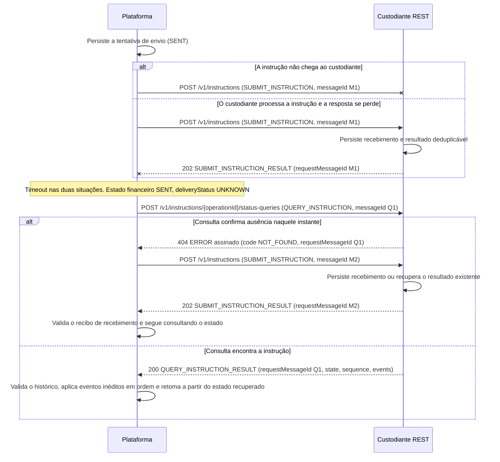

# Recuperação de envio ao custodiante REST

Quando o envio expira sem resposta, a plataforma mantém o último estado financeiro conhecido e marca a entrega ao custodiante como `UNKNOWN`. Ela consulta o custodiante antes de reenviar. Uma resposta válida com o registro permite retomar o fluxo a partir dos eventos persistidos. Um `NOT_FOUND` assinado e correlacionado permite reenviar a mesma instrução. [SPEC — Idempotência e recuperação](../../../SPEC.md#idempotência-e-recuperação)

O diagrama descreve o comportamento especificado para o MVP. O plano `docs/SPRINT-2.md` está ausente nesta revisão, então o texto das tasks S2-07 a S2-10 ficou sem conferência.

## Sequência de recuperação

O contrato OpenAPI chama o envio de `submitInstruction` e a consulta de `queryInstruction`. No diagrama, M1, Q1 e M2 representam UUIDs distintos de `messageId`. Todos os envios e a consulta usam o mesmo `operationId` e `instructionVersion`. O `operationId` no caminho da consulta deve coincidir com `protected.operationId`. [Contrato OpenAPI do custodiante](../../../contracts/openapi/custodian.yaml)

## Como a plataforma decide

- **Consulta.** Cada nova consulta usa um `protected.messageId` próprio e lê o estado atual. Antes de usar a resposta, a plataforma verifica a assinatura e confere o `protected.requestMessageId` com a consulta enviada, além de operação, versão, ambiente, emissor e destinatário. Uma falha na consulta mantém a entrega em `UNKNOWN` e o último estado financeiro conhecido. [Contrato de mensagens](../../../contracts/messages/README.md#tipos-e-obrigatoriedade) · [SPEC — Idempotência e recuperação](../../../SPEC.md#idempotência-e-recuperação)
- **Registro encontrado.** O histórico do custodiante começa em `RECEIVED`, com `sequence = 1` e numeração própria. A plataforma reaplica os eventos intermediários na sua projeção local, ignora os eventos já aplicados e só avança após resolver lacunas e validar as transições. Se o estado recuperado ainda estiver em andamento, continua consultando. [Contrato OpenAPI do custodiante](../../../contracts/openapi/custodian.yaml) · [Estados e eventos](../../../contracts/domain/README.md#sequência-e-recuperação)
- **Ausência confirmada.** Um `404` só justifica reenvio quando traz o envelope `ERROR` assinado e correlacionado, com `payload.code = NOT_FOUND`. O reenvio pode usar um novo `messageId` e assinatura válida, preservando o payload e a chave `(senderId, recipientId, messageType, operationId, instructionVersion)`. Se a tentativa inicial chegar atrasada, a deduplicação preserva o resultado existente para o mesmo payload. Um payload diferente para a mesma chave gera `409 IDEMPOTENCY_CONFLICT`. O `202` confirma o recebimento persistido. A decisão financeira é obtida por consulta. [Contrato OpenAPI do custodiante](../../../contracts/openapi/custodian.yaml) · [SPEC — Idempotência e recuperação](../../../SPEC.md#idempotência-e-recuperação)

## Como demonstrar um único efeito financeiro

Em um cenário de liquidação bem-sucedida com resposta perdida e reenvio, a observação esperada é **um único débito de caixa e um único crédito de ativos** no registro persistido do custodiante para o mesmo `operationId`. O débito deve corresponder ao `grossAmount` e o crédito à `quantity` da boleta. Os dois lançamentos são gravados atomicamente, com unicidade por operação e tipo de lançamento. Respostas iguais podem repetir um resultado já persistido. A contagem dos lançamentos demonstra quantas vezes o efeito financeiro foi aplicado. [SPEC — Estados e registros](../../../SPEC.md#estados-e-registros) · [SPEC — Critério T03](../../../SPEC.md#8-verificação-e-critérios-de-entrega)
